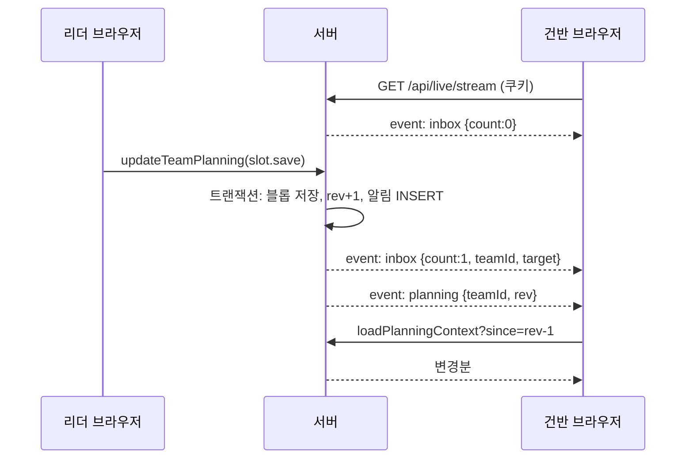
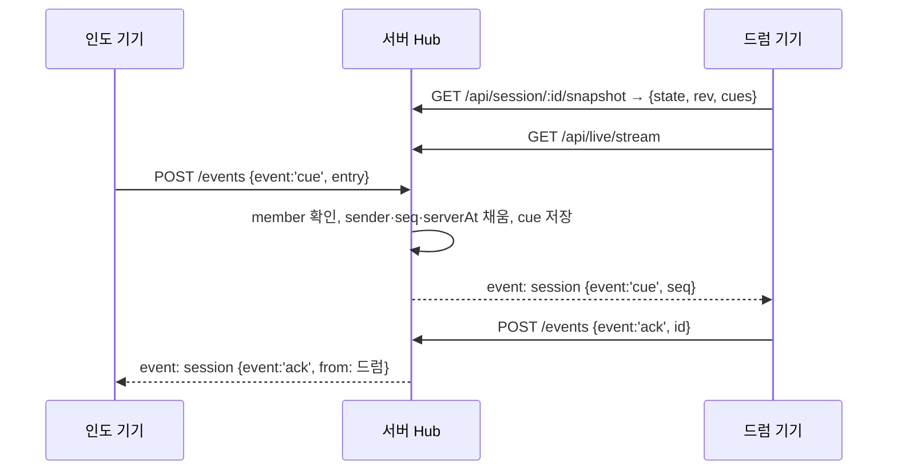

# 로그인 · 팀 · 알림 · 리얼타임 설계와 검증

2026-10-27 기준, 1차 프로토타입 통합본(`claude/trusting-volta-obybpl`)을 코드 감사와 실행 검증으로 확인한 결과와 2차 목표 설계입니다. 각 항목은 **[확인]**(코드·실행으로 검증) 또는 **[추정]**으로 표시합니다.

## 1. 한눈에 보기

| 계층 | 현재 | 판정 | 2차 목표 |
| --- | --- | --- | --- |
| 로그인 | NextAuth v4 JWT, Google·네이버. 신원 = `sha256(provider:accountId)` | 동작. 단 서버 액션 일부가 인증을 안 함 | 그대로 유지. 모든 쓰기 경로에 `getCurrentUser()` 강제 |
| 팀 | SQLite `TeamRepository`. 초대 토큰 해시 저장, 7일 만료, 권한 owner/member | 동작. 권한 가드 일관 | 그대로 유지. 세션 권한도 이 팀 명단으로 판정 |
| 알림 | planning 상태 블롭 안의 `notifications[]`, 15초 폴링 | 동작하지만 비용·지연·노출 문제 | 알림 전용 테이블 + `rev` 커서 + SSE 푸시, 폴링은 폴백 |
| 리얼타임 | BroadcastChannel(같은 브라우저) + Supabase 채널(키 없으면 비활성) | **기기 간 전달 경로 없음**, 세션 쓰기 무인증 | Next.js 서버 중계(SSE + POST), NextAuth 쿠키로 인가, state·큐·스냅샷 서버 보관 |

## 2. 현재 구조 (검증됨)

```mermaid
flowchart LR
  subgraph browser[브라우저]
    UI[화면] -->|server action| SA
    UI -->|15s 폴링| Badge[PlanningInboxBadge]
    Stage[무대 화면] <-->|BroadcastChannel| Stage2[같은 브라우저의 다른 탭]
    Stage -.->|Supabase 키 있을 때만| RT[(Supabase Realtime)]
  end
  subgraph server[Next.js 서버 (단일 Node)]
    SA[actions/*] --> Auth[getCurrentUser · JWT 쿠키]
    SA --> Repo[TeamRepository · SQLite]
    Repo --> Blob[(online_planning.state_json)]
  end
```

### 2.1 로그인

- **[확인]** `lib/authConfig.ts`: JWT 전략, 30일. `jwt` 콜백이 `userId = sha256(provider:providerAccountId)`를 넣고, `session` 콜백은 64자리 hex가 아니면 `user`를 비웁니다. 이메일로 계정을 병합하지 않습니다.
- **[확인]** `NEXTAUTH_URL`이 `http://localhost`이면 `NODE_ENV=production`에서 `ready=false`가 되어 `next start`로 띄운 로컬 서버는 어떤 쿠키도 받지 않습니다. 로컬 검증은 `next dev`로 해야 합니다. (운영은 HTTPS 원점이라 해당 없음.)
- **[확인]** 서명된 JWT 쿠키(`next-auth.session-token`)를 직접 만들어 넣으면 `/api/auth/session`과 서버 액션이 그 사용자로 동작합니다. 이 방식으로 OAuth 키 없이 E2E를 돌렸습니다 (4장).
- **[확인]** 페이지 라우트는 어디에도 로그인 게이트가 없습니다 (`middleware.ts`/`proxy.ts` 없음). 로그인은 개인화와 쓰기 액션에만 쓰입니다.

### 2.2 팀

- **[확인]** `lib/server/teamRepository.ts`: `online_teams`, `online_members(team_id,user_id,role,permission)`, `online_invites(token_hash)`, `online_planning(team_id, state_json)`. WAL, `busy_timeout 5000`.
- **[확인]** 초대는 256비트 토큰, 서버에는 해시만. 새 발급이 이전 링크를 지우고, 취소·만료 토큰은 `join`에서 거부. 팀원 100명, 계정당 30팀 한도.
- **[확인]** 모든 읽기·쓰기가 `member()`/`owner()` 가드를 지납니다. 비소속·탈퇴 사용자는 planning을 읽을 수 없습니다 (`tests/onlineFlow.test.ts`).
- **[확인]** `addMemberDirect`로 넣은 `direct-<uuid>` 팀원은 로그인할 수 없는 자리표시자입니다. 알림 수신자 목록에는 계속 포함됩니다.

### 2.3 알림

- **[확인]** 생성: `lib/planning.ts`의 `notify()`만. 대상은 명령별로 전원 / 인도자 / 관리자 / 그 예배의 인도자+파트 담당(`slotKeepers`) / 대체 후보. 긴급(`urgent`)은 취소·결석·대체·지원·전원 거절. 자리 관련 알림은 `slotId`를 가집니다.
- **[확인]** 저장: 팀당 블롭 한 줄. 읽기는 `SELECT → JSON.parse → zod 검증 → planningForViewer`. 부분 조회·인덱스·버전 필드가 없습니다.
- **[확인]** 소비: `PlanningInboxBadge`가 모든 앱 화면에서 15초마다 `loadPlanningInbox`를 부릅니다. 이 액션은 가입한 **모든 팀의 블롭을 전부 파싱**해서 미확인 개수만 셉니다. 일정·콘티 화면에서는 같은 탭에서 액션이 하나 더 15초마다 나갑니다.
- **[확인]** 상한 기준 측정(팀원 15명, 일정 200·요청 300·알림 500·해결 alerts 200): 블롭 약 1.18MB, parse+zod 약 8.9ms(동기, 이벤트 루프 점유), 비관리자 응답 약 0.86MB. 팀 3개면 폴링 한 번에 약 3.5MB 파싱.
- **[확인]** 읽음: `notification.read`/`readAll`은 `readBy`에 본인만 추가. 남의 알림은 거부. `readAll`은 호출한 팀 한 곳만 적용되어 배지 합계와 어긋날 수 있습니다.
- **[확인]** `planningForViewer`는 알림을 수신자 기준으로 거르지만, 알림 객체의 `recipientIds`·`readBy`를 그대로 내보내 **다른 사람의 읽음 여부가 노출**됩니다.
- **[확인]** 탭 간 갱신 신호(`worship-planning-changed`)는 같은 탭 안에서만 전달됩니다. 다른 탭·기기는 다음 폴링(≤15초)이나 포커스 때 반영됩니다.
- **[확인]** 보관 한도 500을 넘으면 읽지 않은 알림도 오래된 순으로 버려집니다.
- **[확인]** 동시성: 단일 프로세스에서는 `db.transaction` 동기 실행이라 유실이 없습니다. 프로세스 2개가 같은 파일에 동시에 쓰면 `SQLITE_BUSY_SNAPSHOT`로 **저장 실패**가 납니다(실측 80회 중 15회). 유실은 없지만 사용자에게는 일반 오류 문구로만 보이고 재시도가 없습니다.

### 2.4 리얼타임

- **[확인]** 전송: `hooks/useRealtimeSession.ts`가 `BroadcastChannel('worship-together:v1:<team>:<session>')`에 먼저 보내고, Supabase 채널이 구독 중이면 broadcast로도 보냅니다. Supabase 채널은 키가 있고 `isPrototypeSessionId`가 아닐 때만 만들어집니다. DEMO 세션과 콘티 기반 `prototype-*` 세션은 **항상 로컬 전용**입니다.
- **[확인]** `state`(곡·페이지·섹션·BPM) 패킷은 로컬 전용입니다. 원격은 `SessionWorkspace`의 마스터가 `updateSessionState`로 `sessions.current_state`를 쓰고 팔로워가 `postgres_changes`로 받는 별도 경로가 있습니다. 무대 모드(`WorshipTeamMode`)는 이 경로에 연결되어 있지 않아 **무대 화면의 섹션·BPM 변경은 어디로도 나가지 않습니다**.
- **[확인]** 서버 측 중계가 없습니다. `app/api`에는 nextauth 라우트 하나뿐이고 SSE·WebSocket 코드가 없습니다. 따라서 Supabase 키가 없는 현재 프로토타입은 **다른 기기·다른 브라우저로 아무것도 전달하지 못합니다**.
- **[확인]** 인가 공백:
  - `actions/sessionActions.ts`(`appendSessionFeedback`, `updateSessionState`, `startSession`, `endSession` 등)에 `getCurrentUser`·팀 멤버십 확인이 **없습니다**. 세션 id와 팀 id만 알면 로그인 없이 호출됩니다.
  - `supabase/schema.sql`은 `profiles`에만 RLS가 있고 `sessions`·`session_feedback`에는 RLS·publication 설정이 없습니다. anon 키로 읽기·쓰기·채널 조인이 가능합니다.
  - 패킷의 `sender`는 클라이언트가 스스로 적는 값입니다.
- **[확인]** 전달 의미: `ack`는 “기기가 패킷을 처리했다”이며 읽음이 아닙니다. 늦게 들어온 기기는 같은 브라우저의 마스터가 `hello`에 답할 때만 현재 상태를 받습니다. 큐 재생·순서 보장은 없습니다.
- **[확인]** 시작 신호는 전체 대상 큐 하나이고, 카운트인과 BPM 펄스는 각 기기의 로컬 시계로 돕니다. 기기 간 박 위상은 맞지 않습니다(README와 일치).

## 3. 발견한 문제 (우선순위)

| # | 심각도 | 내용 | 근거 |
| --- | --- | --- | --- |
| P1 | 높음 | 세션 서버 액션과 Supabase 테이블이 무인증·무RLS. 세션 id를 아는 누구나 큐 기록·상태 변경·세션 종료 가능 | `actions/sessionActions.ts`, `supabase/schema.sql` |
| P2 | 높음 | 기기 간 리얼타임 경로가 실제로 없음(Supabase 없을 때). 무대 모드 state는 Supabase가 있어도 전달 안 됨 | `useRealtimeSession.ts:84-92`, `WorshipTeamMode.tsx` |
| P3 | 중간 | 알림 폴링이 가입 팀 전체 블롭을 15초마다 파싱. 팀·탭 수에 비례해 서버 CPU·전송량 증가 | `planningActions.ts:33-42`, 측정값 |
| P4 | 중간 | 알림 객체가 다른 수신자의 `readBy`·`recipientIds`를 노출 | `planningForViewer`, `tests/onlineFlow.test.ts` 마지막 테스트 |
| P5 | 중간 | 다중 프로세스 배포 시 `SQLITE_BUSY_SNAPSHOT` 저장 실패, 재시도 없음 | 실측 |
| P6 | 낮음 | `readAll`이 팀 단위라 배지 합계와 불일치. 미확인 알림도 500 한도에 밀려 삭제 | `lib/planning.ts:959` |
| P7 | 낮음 | 죽은 코드: `session-feedback` broadcast 리스너(송신자 없음) | `useRealtimeSession.ts:167-173` |

## 4. 검증 결과

### 4.1 자동 테스트

| 종류 | 파일 | 내용 | 결과 |
| --- | --- | --- | --- |
| 인증 | `components/auth/auth.test.cjs` | 실제 NextAuth 코어로 Google·네이버 콜백, CSRF, 세션 콜백 (HTTP만 모의) | 통과 (기존) |
| 팀 | `tests/teamRepository.test.ts` | 초대·참여·권한·토큰 회전·만료 | 통과 (기존) |
| 알림 규칙 | `tests/planning.test.ts`, `contiPlanning.test.ts`, `schedule_rsvp.test.ts` | 수신 대상, 읽음 권한, 파트 담당·대체 부탁 | 통과 (기존) |
| **흐름 통합** | `tests/onlineFlow.test.ts` (신규) | 신원 규칙 → 팀 생성 → 초대 참여 → 배정 알림 → 읽음 → 불참·긴급 알림 → 다중 팀 배지 집계 → 외부인·탈퇴자·취소 초대 거부 → 읽음 노출 | 6/6 통과 |

실행: `npm test` (전체 238개).

### 4.2 브라우저 E2E (서명된 테스트 세션)

OAuth 키 없이 `next dev` + 격리된 SQLite + 직접 서명한 JWT 쿠키 두 개(리더·건반)로 실제 화면을 조작했습니다. 스크립트는 저장소 밖(스크래치)에 두었고 제품 코드는 바꾸지 않았습니다.

| 단계 | 결과 | 확인 내용 |
| --- | --- | --- |
| 팀 생성 | 통과 | "E2E 예배팀", 리더 = 인도자·관리자 |
| 초대 링크 발급 | 통과 | `/invite/<64hex>` |
| 건반 팀원 초대 수락 | 통과 | "테스트 건반 님으로 참여합니다" → 팀원으로 참여 |
| 역할 변경 | 통과 | 새로고침 후에도 "건반 · 팀원" |
| 일정 생성·배정 | 통과 | `event.save` + `slot.save` (UI 경유) |
| 팀원 배지·읽음 | 통과 | "새 알림 2건" → 모두 읽음 → 배지 사라짐 |
| 불참 → 리더 긴급 알림 | 통과 | "긴급 미확인 1건 · 결석 · 대체 인원이 필요해요" |
| 큐, 같은 브라우저 두 탭 | 통과 | 수신 3~5ms, "1개 기기 수신 · 확인됨" |
| 큐, 다른 브라우저 | 예상된 한계 | 5초 내 미수신 (BroadcastChannel 전용) |
| 비소속 팀 접근 | 통과 | 비공개 팀 자료가 HTML에도 노출되지 않음 |

측정값:

| 항목 | 값 |
| --- | --- |
| 배지 반영, 열어둔 페이지 | 11.6 ~ 13.6초 (15초 폴링 주기) |
| 배지 반영, 새로 연 페이지 | 약 0.5초 |
| 읽음 후 배지 소거 | 6ms |
| 큐 전달 (탭 간) | 3 ~ 5ms, ACK 표시 208ms |

E2E에서 추가로 발견한 결함 (**2026-10-28 모두 수정**: `lib/planningView.ts`의 `pickNextDuty`·`summarizeMyDuties`, `PlanningWorkspace`의 비소속 팀 안내·주소 교체, 대시보드 홈의 서버 팀 명단 표시):

- **[확인] 불참한 일정이 "나의 다가오는 섬김"에 "확정됨"으로 남습니다.** `components/planning/SchedulePanel.tsx`의 `nextDuty`가 참석 상태를 거르지 않습니다. 같은 화면의 일정 행과 긴급 알림은 불참으로 맞게 표시됩니다.
- **[확인] 비소속 팀 id로 `/dashboard/planning?team=`에 들어가면 안내 없이 본인 팀으로 대체됩니다** (`PlanningWorkspace.tsx`의 `?? props.teams[0]`). 데이터 노출은 없으나 URL이 그대로 남아 혼란을 줍니다.
- **[확인] 대시보드 홈(`WorshipHome`)은 온라인 팀이 아니라 브라우저 체험 팀만 읽어** 로그인해도 "기본 예배팀 · 팀원 0명"으로 보입니다.

## 5. 2차 목표 설계

원칙: **신원은 NextAuth 하나**, **저장은 SQLite 하나(단일 Node 서버)**, **전송은 3계층(BroadcastChannel → 서버 SSE → 폴링 폴백)**. Supabase는 곡·콘티 저장용으로 남기되 리얼타임·세션 인가의 근거로 쓰지 않습니다.

```mermaid
flowchart LR
  subgraph client[브라우저]
    App[화면] -->|server action / POST| API
    App <-->|EventSource| SSE
    App <-->|BroadcastChannel| Tab2[같은 브라우저 탭]
  end
  subgraph server[Next.js 서버]
    API[route handlers + actions] --> Auth[getCurrentUser]
    Auth --> Member[TeamRepository.member]
    API --> DB[(SQLite)]
    API --> Hub[LiveHub · in-process]
    Hub --> SSE[/api/live/stream]
  end
```

### 5.1 데이터 모델

```sql
-- 알림을 블롭에서 분리
CREATE TABLE online_notifications (
  id TEXT PRIMARY KEY, team_id TEXT NOT NULL REFERENCES online_teams(id) ON DELETE CASCADE,
  title TEXT NOT NULL, body TEXT NOT NULL, urgent INTEGER NOT NULL DEFAULT 0,
  target TEXT NOT NULL, entity_id TEXT NOT NULL, slot_id TEXT, created_at TEXT NOT NULL);
CREATE TABLE online_notification_recipients (
  notification_id TEXT NOT NULL REFERENCES online_notifications(id) ON DELETE CASCADE,
  user_id TEXT NOT NULL, read_at TEXT, PRIMARY KEY (notification_id, user_id));
CREATE INDEX notif_unread ON online_notification_recipients(user_id, read_at);

-- 변경 감지 커서
ALTER TABLE online_planning ADD COLUMN rev INTEGER NOT NULL DEFAULT 0;

-- 라이브 세션 (Supabase sessions 대체 또는 병행)
CREATE TABLE online_live_sessions (
  session_id TEXT PRIMARY KEY, team_id TEXT NOT NULL REFERENCES online_teams(id) ON DELETE CASCADE,
  state_json TEXT NOT NULL, rev INTEGER NOT NULL DEFAULT 0,
  master_user_id TEXT, master_client_id TEXT, master_lease_until TEXT, updated_at TEXT NOT NULL);
CREATE TABLE online_live_cues (
  id TEXT PRIMARY KEY, session_id TEXT NOT NULL, seq INTEGER NOT NULL,
  sender_user_id TEXT NOT NULL, sender_client_id TEXT NOT NULL,
  entry_json TEXT NOT NULL, created_at TEXT NOT NULL);
CREATE INDEX cue_seq ON online_live_cues(session_id, seq);
```

- `notify()`는 그대로 두되 결과를 블롭이 아니라 위 두 테이블에 쓰고, `planningForViewer`는 `notifications`를 내보내지 않습니다. 클라이언트에는 `{id,title,body,urgent,target,entityId,slotId,createdAt,read:boolean}`만 갑니다 (P4 해소).
- `direct-*` 팀원은 수신자에서 제외합니다. 보관은 사용자별 N건, 읽은 것부터 정리 (P6 해소).
- 쓰기 트랜잭션은 `db.transaction(...).immediate()`로 바꾸고 `SQLITE_BUSY*`에 한 번 재시도 + 한글 오류 (P5 완화).

### 5.2 서버 API

| 경로 | 방식 | 인가 | 역할 |
| --- | --- | --- | --- |
| `GET /api/live/stream` | SSE (`runtime=nodejs`) | 쿠키 → `getCurrentUser` | 사용자 한 명당 연결 하나. 이벤트: `inbox {count,urgent,teamId,...}`, `planning {teamId,rev}`, `session {sessionId,seq,…}`. 첫 이벤트로 현재 스냅샷 전송. 25초 `: ping` |
| `POST /api/session/[id]/events` | JSON | 쿠키 + `member(team_id)` | 큐·ack·presence·state 패킷 수신. 서버가 `sender = userId:clientId`, `seq`, `serverAt`를 채워 Hub로 방송. `state`는 마스터 리스 보유자만 |
| `POST /api/session/[id]/master` | JSON | 쿠키 + member | 마스터 리스 획득·갱신(30초)·반납. 한 명만 |
| `GET /api/session/[id]/snapshot` | JSON | 쿠키 + member | `{state, rev, cues: 최근 50, serverNow}` 늦게 들어온 기기용 |
| 기존 `actions/sessionActions.ts` | server action | **`getCurrentUser` + member 추가** | Supabase 쓰기는 service-role 키로 서버에서만. anon 직접 쓰기 금지 (P1 해소) |
| 기존 `loadPlanningInbox` | server action | 그대로 | SQL 한 번: `SELECT count(*), sum(urgent) … WHERE user_id=? AND read_at IS NULL`. 폴백 폴링 60초 (P3 해소) |

`LiveHub`는 프로세스 내 `Map<topic, Set<Response>>`입니다. 단일 서버 전제(이미 SQLite로 고정)와 맞습니다. 인스턴스를 늘릴 때는 Hub 뒤에 Redis pub/sub를 끼우는 한 지점만 바꿉니다.

### 5.3 클라이언트

- `useRealtimeSession`의 `send()`에 세 번째 전송 `'sse'`(실제로는 POST 송신 + SSE 수신)를 추가합니다. `Packet`, `seenCues`, `ack` 로직은 재사용. `publishState()`는 `send('state')`로 바꾸고, 수신 측의 `transport === 'local'` 조건을 서버 `rev` 비교로 교체합니다 (P2 해소).
- 무대 모드에 “인도 기기” 토글(마스터 리스)을 추가해 섹션·BPM 변경이 서버로 나가게 합니다.
- 시작 신호에 `startAt = serverNow + 3s`와 BPM을 실어 수신 기기가 자동으로 같은 순간에 카운트인을 시작합니다. 박 위상 보정은 `serverNow - Date.now()` 오프셋(연결 시 1회 측정)으로 1차 근사. 정밀 동기는 범위 밖.
- `PlanningInboxBadge`: SSE `inbox` 이벤트를 우선, 폴링은 60초 폴백. 같은 브라우저 탭 간에는 `BroadcastChannel('worship-together:inbox')`로 즉시 전파.

### 5.4 권한 매트릭스

| 행위 | 비로그인 | 팀원 | 파트 담당 | 관리자(owner) |
| --- | --- | --- | --- | --- |
| 페이지 보기(데모 자료) | ○ | ○ | ○ | ○ |
| 팀 자료·알림 읽기 | × | 본인 팀만 | 본인 팀만 | 본인 팀만 |
| 알림 읽음 처리 | × | 본인 것만 | 본인 것만 | 본인 것만 |
| 일정 저장·배정 | × | × | × | ○ (인도자 role 포함) |
| 대체 확정 | × | × | 해당 파트 | ○ |
| 세션 큐 송신·ack·presence | × | ○ | ○ | ○ |
| 세션 state 송신 | × | 마스터 리스 보유 시 | 〃 | 〃 |
| 세션 시작·종료 | × | × | × | ○ 또는 그 예배 인도자 |

### 5.5 시퀀스 (알림 푸시)



### 5.6 시퀀스 (예배 중 큐, 기기 간)



## 6. 단계별 적용 계획

각 단계는 독립 PR이며, 앞 단계 없이도 동작합니다.

| 단계 | 변경 | 검증 |
| --- | --- | --- |
| 1 | `sessionActions.ts` 전부에 `getCurrentUser`(**적용됨**, 2026-10-28) + 팀 멤버십(Supabase 팀 id와 서버 팀 명단 통합 후). Supabase 서버 쓰기를 service-role로, `sessions`·`session_feedback` RLS로 anon 쓰기 차단. 죽은 리스너 제거 | 비로그인 호출이 거부되는 단위 테스트. E2E: B가 다른 팀 세션에 큐를 보내면 거부 |
| 2 | 알림 테이블 분리 + `rev` + `loadPlanningInbox` SQL화 + `planningForViewer`에서 `readBy` 제거 + `.immediate()` | `onlineFlow.test.ts`를 새 저장 구조로 통과. 상한 데이터에서 inbox 응답 < 2KB, < 2ms 측정 |
| 3 | `LiveHub` + `/api/live/stream` + Badge SSE 우선/폴링 폴백 60초 | E2E: 배지 반영 지연 < 1초 (현재 ≤15초). 연결 끊김 후 폴백 동작 |
| 4 | `/api/session/[id]/events`·`snapshot`·`master` + `useRealtimeSession` SSE 전송 + 무대 모드 마스터 토글 | E2E: 서로 다른 브라우저 컨텍스트 간 큐·ack·state 전달. 늦게 들어온 기기 스냅샷 복구 |
| 5 | 시작 신호 `startAt` + 서버 시각 오프셋 | 두 컨텍스트의 카운트인 시작 시각 차이 측정(목표 < 300ms) |

## 7. 열린 결정

1. Supabase를 곡·콘티 저장에 계속 쓸지, SQLite로 모을지. 리얼타임·인가는 어느 쪽이든 위 설계(Next 서버 중계)로 갑니다.
2. 무대 모드에서 마스터를 누가 잡는지: 그 예배의 인도자 자리 담당을 기본값으로, 관리자가 넘겨받을 수 있게 하는 안을 권합니다.
3. 알림 보관 한도를 사용자별 몇 건으로 할지(제안: 300, 읽은 것부터 정리).
