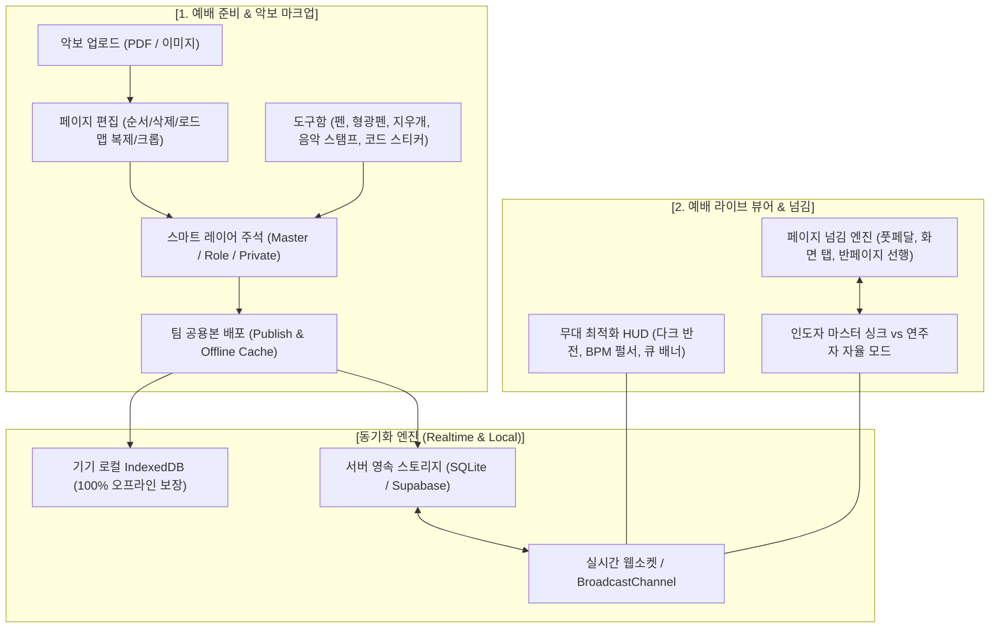
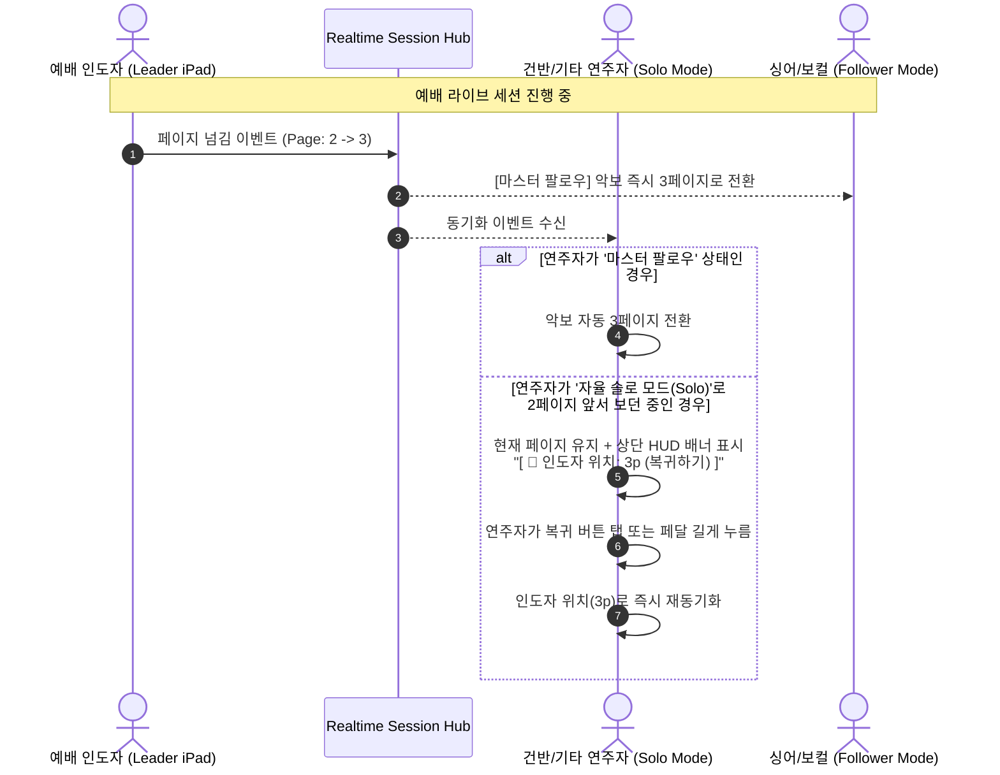

# 악보 시스템 기획서: 스마트 마크업 & 예배 라이브 뷰어

> **문서 버전:** v1.0.0  
> **상태:** 기획 확정 및 개발 준비 단계 (Approved Specification)  
> **작성 대상:** 예배 기획자, 찬양 인도자, 연주자(건반·드럼·기타·베이스), 싱어, 방송·음향 엔지니어

---

## 1. 기획 배경 및 문제 정의

### 1.1 배경 및 현장 페인포인트
기존 교회 찬양팀의 악보 사용 방식은 크게 **'종이 인쇄물'**과 **'개인용 태블릿 앱(forScore 등)'**으로 양분되어 있습니다. 그러나 실제 예배 현장에서는 다음과 같은 중대한 한계가 발생합니다:

1. **공유 및 파트별 조율의 부재**
   - 콘티가 확정된 후 송폼(Intro-Verse-Chorus-Bridge 등)이나 Key(조)가 변경되면 종이 악보를 전면 재인쇄해야 합니다.
   - 인도자의 디렉팅 메모(예: "2절 후렴 빌드업", "간주 8마디 후 자유 찬양")를 팀원들이 각자 수기로 받아 적다 보니 누락이나 오차가 빈번합니다.
2. **파트별 요구 정보의 상이함**
   - **인도자/싱어:** 가사 호흡, 화음(소프/알토/테너), 멘트 타이밍, 다음 곡 연결 흐름
   - **건반(메인/세컨):** 코드 보이싱, 전주/간주 멜로디 라인, 패드/신스 사운드 전환
   - **드럼/베이스:** 리듬 섹션 킥 악센트, 빌드업 타이밍, 브레이크(Break) 구간
   - *단일 레이어 악보에서는 모든 파트의 메모가 뒤섞여 가독성이 급격히 떨어집니다.*
3. **예배 라이브 진행 중 '악보 넘김' 사고**
   - 양손으로 연주하는 건반/기타/드럼 연주자는 연주 도중 손으로 태블릿을 넘기기 어렵습니다.
   - 인도자가 성령의 감동이나 현장 분위기에 따라 즉흥적으로 "후렴 한 번 더(Vamp)"를 반복할 때, 악보 페이지를 뒤로 넘기지 못해 연주가 멈추거나 박자를 놓치는 사고가 자주 일어납니다.
4. **무대 조명과 시각 환경**
   - 예배당 조명이 어두워질 때 흰색 배경의 태블릿 악보는 연주자의 얼굴을 하얗게 비추어 회중의 예배 몰입을 방해하고 연주자의 눈을 피로하게 만듭니다.

### 1.2 목표 (Goal)
- **준비 단계:** 원본 악보(PDF/이미지) 등록부터 파트별 다중 레이어 마크업, 원클릭 팀 공유까지 하나의 웹·앱 환경에서 완결.
- **예배 라이브:** 블루투스 풋페달 완벽 지원, 반페이지 선행 넘김, 인도자-팔로워 싱크, 다크 무대 반전 HUD를 통해 **"연주가 끊기지 않고 인도자의 호흡을 한눈에 보는 라이브 무대 경험"** 제공.

---

## 2. 전체 시스템 구성도



---

## 3. 기능 명세 1: 악보 수정·편집, 마크업 및 공유

### 3.1 악보 원본 관리 및 로드맵 편집 (Roadmap Arranger)
- **지원 포맷:** PDF(벡터 해상도 보존), PNG, JPEG, WebP. (최대 30페이지, 파일당 50MB 지원)
- **여백 자동 트리밍 (Auto White-space Crop):** 태블릿 화면 비율에 맞춰 악보 주변의 불필요한 흰 여백을 1탭으로 잘라내어 음표를 최대 크기로 확대.
- **가로/세로 회전 & 페이지 순서 변경:** 드래그 앤 드롭으로 곡 진행 순서에 맞게 페이지 재정렬.
- **★ 도돌이표 로드맵 복제 (Roadmap Layout):**
  - 찬양팀 연주에서 도돌이표(D.S., D.C.)로 인해 3페이지에서 다시 1페이지로 돌아가야 하는 경우, **페달을 뒤로 밟지 않고 앞으로만 밟을 수 있도록** 특정 페이지(예: 1페이지 후렴)를 원하는 순서 뒤에 가상/실제 복제 삽입(예: `1p -> 2p -> 3p -> 1p(후렴 복제) -> 4p`).

### 3.2 3단계 멀티 레이어 마크업 시스템 (Multi-Layer Annotation)
악보 주석을 하나의 그림으로 뭉개지 않고 3개의 계층으로 분리하여 관리합니다.

| 레이어 구분 | 작성 권한 | 읽기 권한 | 주요 표기 내용 |
| :--- | :--- | :--- | :--- |
| **1. 마스터 레이어 (Master)** | 찬양 인도자, 팀 리더 | 팀원 전체 (기본 활성) | 공식 송폼(Intro, Verse, Chorus, Outro), 도돌이 횟수, 템포 변화, 키 변경 |
| **2. 파트 레이어 (Role)** | 해당 파트 담당자 | 해당 파트 팀원 (선택적 전체) | 건반 보이싱, 드럼 리듬 섹션 킥 악센트, 베이스 런, 싱어 화음 및 가사 발음 |
| **3. 개인 레이어 (Private)** | 로그인한 본인 | 본인만 열람 | 개인 연습 메모, 손가락 번호, 나만의 팁 (다른 사람에게 노출 안 됨) |

- **레이어 오버레이 스위처:** 화면 상단에서 `[ 마스터 ]`, `[ 내 파트(건반) ]`, `[ 개인 메모 ]` 눈 모양 아이콘을 켜고 끌 수 있어 가독성 극대화.

### 3.3 스마트 마크업 툴킷 (Annotation Toolkit)
1. **정밀 드로잉 펜 & 형광펜:**
   - Apple Pencil / S-Pen 틸트 및 필압 지원, 손가락 터치와 스타일러스 자동 분기(Palm Rejection).
   - 형광펜(Highlighter): `Multiply` 블렌딩 모드를 적용하여 형광펜을 칠해도 악보의 오선지와 음표, 가사가 전혀 가려지지 않음 (투명도 40%, 노랑/초록/분홍/하늘).
2. **획 단위 지우개 (Stroke Eraser) & 올가미 선택:**
   - 문지르지 않고 터치 한 번으로 그어진 획 전체를 삭제.
3. **예배 전용 음악 스탬프 (Worship Stamps):**
   - **진행 기호:** `1x`, `2x`, `3x`, `D.S.`, `D.C.`, `Coda`, `Fermata`, `Fine`, `Vamp(반복)`
   - **다이내믹스:** `pp`, `p`, `mp`, `mf`, `f`, `ff`, `Crescendo(점점 크게)`, `Decrescendo(점점 작게)`
   - **예배 디렉팅:** `한 번 더`, `후렴 반복`, `브릿지 점프`, `기도 반주`, `자유 찬양`, `멘트`, `드럼 Solo`, `Tutti(전체)`
4. **코드 조옮김 오버레이 스티커 (Transpose Sticker):**
   - 원래 악보의 코드 위에 새 코드를 덧붙여 표시할 수 있는 코드 텍스트 칩 (예: `F` 위에 `G` 스티커 부착).
5. **텍스트 메모 박스:**
   - 클릭 위치에 즉시 텍스트 입력, 배경색 불투명도 및 글자 크기 지정 가능.

### 3.4 팀 동기화 및 공유 프로토콜
- **오프라인 우선 (Offline-First):** 모든 필기 데이터는 벡터 스트로크(Vector Coordinates JSON) 형태로 IndexedDB에 100ms 이내 자동 저장. 오프라인 상태에서도 100% 정상 작동.
- **원클릭 공용본 배포 (Publish to Team):**
  - 인도자가 [전체 공유본 배포] 버튼을 누르면 서버 DB 및 웹소켓을 통해 실시간 푸시.
  - 팀원의 화면에 토스트 알림: *"인도자의 최신 악보 마크업이 반영되었습니다."* (기존 개인 메모는 그대로 보존되며 마스터 레이어만 갱신).
- **외부 내보내기 & 공유:**
  - 마크업이 합성된 고해상도 PDF 내보내기 (주석 포함 인쇄 가능).
  - Worship Together 전용 악보 패키지(`.wtsheet` / JSON) 파일로 에어드롭 및 카카오톡 전송 지원.

---

## 4. 기능 명세 2: 예배 라이브 악보 뷰어 & 무대 넘김

### 4.1 무대 최적화 뷰어 환경 (Stage-Optimized Viewer)
1. **다크 무대 반전 모드 (Stage Inversion / Dark Score):**
   - 조명이 어두운 예배당 무대 환경을 위해 검은 배경에 흰색 오선지/음표로 반전 렌더링.
   - 웜톤/앰버 필터(Amber Shield): 눈부심과 청색광을 억제하여 시력 보호 및 연주자 얼굴 비침 방지.
2. **3가지 디스플레이 뷰 모드:**
   - **단면 모드 (Single Page):** 스마트폰 및 세로 모드 태블릿을 위한 1페이지 꽉 찬 화면.
   - **양면 펼침 모드 (Two-page Spread):** 12인치 이상 대형 태블릿(iPad Pro, Galaxy Tab S9 Ultra 등) 가로 모드 시 종이 악보책처럼 좌우 2페이지 동시 표시.
   - **★ 반페이지 선행 넘김 모드 (Half-Page Smart Turner):**
     - 연주 중 한 페이지를 통째로 넘기면 순간적으로 시선을 잃는 문제를 해결.
     - 1회 페달 입력 시: 상단 절반이 다음 페이지의 상단으로 먼저 전환 (하단은 현재 페이지 유지하여 연주 지속).
     - 2회 페달 입력 시: 하단 절반까지 다음 페이지로 완전히 전환.
3. **스테이지 HUD (Head-Up Display) 오버레이:**
   - 악보 상단/하단에 반투명 플로팅 바 배치:
     - **시각적 비트 펄서 (Silent BPM Metronome):** 소리 없이 깜빡이는 시각 비트 (다운비트 강조)로 팀 템포 유지.
     - **송폼 네비게이터:** `[Intro] - [Verse 1] - [Chorus ●] - [Bridge]` 현재 섹션 하이라이트.
     - **실시간 즉시 큐 배너 (Live Cue Banner):** 인도자가 "한 번 더" 또는 "기도 반주 전환" 큐를 전송하면 악보 상단에 굵은 네온 토스트로 3초간 표시 후 부드럽게 퇴장.
     - **미니 세틀리스트:** 콘티 내 이전 곡 / 다음 곡 타이틀 및 Key 표시.

### 4.2 입력 제어 및 블루투스 풋페달 연동
1. **블루투스 악보 페달 완벽 호환:**
   - 지원 기기: AirTurn (PEDpro, Duo500), PageFlip (Firefly, Butterfly), Donner, iRig BlueTurn, Coda Stomp 등 표준 HID 키보드 모드 지원 기기.
   - 기본 매핑:
     - `Right Pedal / PageDown / ArrowRight / Space`: 다음 페이지 / 반페이지 넘김
     - `Left Pedal / PageUp / ArrowLeft / Backspace`: 이전 페이지
     - `Long Press / Double Tap`: 다음 곡으로 점프 / 이전 곡으로 점프
2. **커스텀 페달 키 바인딩 설정:**
   - 페달 제조사별 키 코드 커스텀 설정 지원 (사용자 정의 키 매핑 UI 제공).
3. **터치 제스처 존 (Touch Zones):**
   - 화면 우측 30%: 다음 페이지 | 화면 좌측 30%: 이전 페이지 | 화면 상단 20%: 메뉴 HUD 열기/닫기.
4. **무대 잠금 모드 (Stage Lock):**
   - 악보 연주 중 손가락이 화면에 닿아 필기가 되거나 다른 메뉴가 열리는 사고를 방지하기 위해, 오직 페달/지정 탭만 동작하도록 화면 터치를 잠그는 원터치 락 기능.
5. **화면 꺼짐 방지 (Screen Wake Lock):**
   - 라이브 모드 진입 시 브라우저 절전 모드 자동 차단.

### 4.3 인도자 - 팀원 간 라이브 동기화 아키텍처



- **Master Sync vs Free Solo 전환:**
  - 화면 상단에 싱크 토글 버튼: `[ 🔗 인도자 싱크 중 ]` ↔ `[ 👤 내 속도로 보기 ]`
  - 싱어 파트는 기본적으로 마스터 싱크 모드로 동작하여 길을 잃지 않음.
  - 연주 파트는 솔로 모드로 전환하여 브릿지나 간주 코드를 미리 열람 가능.

---

## 5. 데이터 모델 및 스키마 설계

### 5.1 데이터베이스 테이블 (SQLite & Supabase)

```sql
-- 악보 문서 메타데이터
CREATE TABLE sheet_documents (
    id TEXT PRIMARY KEY,
    team_id TEXT NOT NULL,
    song_id TEXT NOT NULL,
    title TEXT NOT NULL,
    original_key TEXT,
    page_count INTEGER NOT NULL DEFAULT 1,
    aspect_ratio REAL NOT NULL DEFAULT 0.707, -- A4 비율 기준
    created_at DATETIME DEFAULT CURRENT_TIMESTAMP,
    updated_at DATETIME DEFAULT CURRENT_TIMESTAMP
);

-- 악보 페이지 원본 에셋
CREATE TABLE sheet_pages (
    id TEXT PRIMARY KEY,
    document_id TEXT NOT NULL REFERENCES sheet_documents(id) ON DELETE CASCADE,
    page_number INTEGER NOT NULL,
    image_url TEXT NOT NULL, -- 고화질 원본 이미지 URL (WebP)
    thumbnail_url TEXT,
    width INTEGER NOT NULL,
    height INTEGER NOT NULL,
    UNIQUE(document_id, page_number)
);

-- 멀티 레이어 마크업 데이터 (벡터 스트로크 및 스탬프)
CREATE TABLE sheet_annotations (
    id TEXT PRIMARY KEY,
    document_id TEXT NOT NULL REFERENCES sheet_documents(id) ON DELETE CASCADE,
    page_number INTEGER NOT NULL,
    layer_type TEXT CHECK(layer_type IN ('master', 'role', 'private')) NOT NULL,
    target_role TEXT, -- 'vocal', 'keys', 'guitar', 'drums', 'bass', NULL(전체)
    author_id TEXT NOT NULL,
    strokes_data JSON NOT NULL, -- 마크업 스트로크, 텍스트, 스탬프 JSON 배열
    version INTEGER NOT NULL DEFAULT 1,
    updated_at DATETIME DEFAULT CURRENT_TIMESTAMP
);
```

### 5.2 마크업 스트로크 데이터 구조 (`strokes_data` JSON)

```typescript
export interface SheetStroke {
  id: string;
  kind: 'pen' | 'highlighter' | 'eraser' | 'stamp' | 'text' | 'chord_sticker';
  color: string;         // Hex (#ff0000) or RGBA (rgba(255, 235, 59, 0.45))
  width: number;         // 굵기 (1 ~ 16)
  opacity: number;       // 형광펜 투명도 (0.1 ~ 1.0)
  points: [number, number][]; // 0~1000 상대 정규화 좌표 [x, y]
  text?: string;         // 텍스트 박스 내용 또는 스탬프 라벨
  fontSize?: number;     // 텍스트 크기
  targetSection?: string;// 송폼 연동 시 지정 섹션 ('Chorus 1')
  createdAt: string;
}
```

### 5.3 실시간 웹소켓 이벤트 프로토콜 (Live Protocol)

```typescript
export type SheetRealtimeMessage =
  | {
      event: 'SHEET_PAGE_TURN';
      sessionId: string;
      songId: string;
      page: number;
      leaderClientId: string;
      timestamp: number;
    }
  | {
      event: 'SHEET_SECTION_JUMP';
      sessionId: string;
      songId: string;
      section: string;
      targetPage: number;
    }
  | {
      event: 'STAGE_CUE_DISPATCH';
      cueId: string;
      label: string; // '한 번 더', '후렴 반복', '기도 반주'
      colorAccent: string;
      targetRole?: string;
    }
  | {
      event: 'SHEET_ANNOTATION_SYNC';
      documentId: string;
      pageNumber: number;
      layerType: 'master' | 'role';
      version: number;
    };
```

---

## 6. UI / UX 화면 구성 및 인터랙션

### 6.1 [화면 1] 악보 마크업 & 편집 모드 (Desktop & Tablet)
```
+-------------------------------------------------------------------------+
| [← 콘티로]  곡명: 주 은혜임을 (Key: G / 72 BPM)      [팀 공용본 배포] [PDF 내보내기] |
+-------------------------------------------------------------------------+
| [도구바]                                                                |
| [이동/선택] [펜▼] [형광펜▼] [지우개] [스탬프▼] [코드스티커] [텍스트] [되돌리기]   |
| [색상: ● ● ● ●] [굵기: -●-] | [레이어: ☑마스터  ☑내파트(건반)  ☑개인]       |
+-------------------------------------------------------------------------+
|                                                                         |
|   +-----------------------------------------------------------------+   |
|   |  (A4 크롭된 고해상도 악보 영역)                                 |   |
|   |                                                                 |   |
|   |  Intro  [G]           [D/F#]        [Em7]                       |   |
|   |  -------------------------------------------------------------  |   |
|   |  [형광펜 하이라이트]                                            |   |
|   |  주 나의 모습 보시네                                             |   |
|   |                                                                 |   |
|   |  Chorus                                                         |   |
|   |  [스탬프: 🔁 한 번 더 (빌드업)]                                 |   |
|   +-----------------------------------------------------------------+   |
|                                                                         |
+-------------------------------------------------------------------------+
| [◀ 이전]  페이지: 1 / 3  (로드맵: 1p - 2p - 1p - 3p)  [다음 ▶]  [여백 자르기] |
+-------------------------------------------------------------------------+
```

### 6.2 [화면 2] 예배 라이브 무대 뷰어 모드 (Stage HUD Mode)
```
+-------------------------------------------------------------------------+
| [STAGE HUD]  BPM 72 (● ○ ○ ○) | 현재: [Chorus] -> 다음: [Bridge] | 🔗 인도자 싱크 |
| [무대 반전: ON] [화면 꺼짐 방지: ON] [무대 터치 잠금: ON] [페달 연결됨 ⌨️]       |
+-------------------------------------------------------------------------+
|                                                                         |
|  +-------------------------------------------------------------------+  |
|  |  [★ 실시간 인도자 큐 알림 플래시 배너: "🔁 후렴 한 번 더! (전체)"]  |  |
|  +-------------------------------------------------------------------+  |
|                                                                         |
|   (다크 반전 악보 - 검은 배경에 흰색 오선지와 뚜렷한 주석)              |
|                                                                         |
|   [Chorus]                                                              |
|   주 은혜임을 날마다 고백하네...                                         |
|                                                                         |
|                                                                         |
|                                                                         |
|  ---------------------------------------------------------------------  |
|  [반페이지 선행 넘김 라인: 다음 페달 입력 시 하단이 2페이지로 전환됩니다] |
+-------------------------------------------------------------------------+
| [곡 1/4] 주 은혜임을 (G) | [◀ 이전 페이지]  2 / 3  [다음 페이지 ▶] | [다음 곡: 은혜로다 ▶] |
+-------------------------------------------------------------------------+
```

---

## 7. 단계별 개발 및 출시 로드맵 (Roadmap)

### Phase 1: 로컬 마크업 고도화 & 라이브 무대 뷰어 통합 (MVP)
- **목표:** 현재의 단편적인 악보 컴포넌트를 `WorshipTeamMode`의 메인 뷰로 결합하고 핵심 사용성 확보.
- **주요 작업:**
  1. `WorshipTeamMode` 중앙 패널에 악보 뷰어 전면 배치 (기존 BPM 패널과 상단 HUD로 압축 통합).
  2. 펜/형광펜(Multiply 블렌딩)/획 지우개/기본 음악 스탬프 완성.
  3. 무대 다크 반전 모드(Dark Invert Filter) 및 무대 터치 잠금(Stage Lock) 구현.
  4. 블루투스 페달 단축키 매핑 최적화 (`usePageTurner`).

### Phase 2: 멀티 레이어 & 팀 클라우드 동기화
- **목표:** 개인 기기에만 머물던 악보 데이터를 팀 단위 협업 클라우드로 확장.
- **주요 작업:**
  1. `sheet_documents`, `sheet_pages`, `sheet_annotations` DB 스키마 구축 및 API 연동.
  2. 마스터 / 파트 / 개인 3단계 레이어 스위처 구현.
  3. [팀 공용본으로 배포] 시 실시간 웹소켓 푸시 및 타 기기 자동 머지.
  4. 오프라인 IndexedDB 자동 캐싱 및 온라인 복귀 시 백그라운드 싱크.

### Phase 3: 무대 연주자 특화 기능 (반페이지 선행 & 로드맵)
- **목표:** 전문 연주자(건반·드럼)들의 무대 연주 경험 극대화.
- **주요 작업:**
  1. **반페이지 선행 넘김 (Half-Page Smart Turner)** 듀얼 렌더링 구현.
  2. 도돌이표 전용 페이지 복제 배치를 지원하는 **로드맵 레이아웃(Roadmap Layout)**.
  3. 인도자 마스터 싱크 ↔ 연주자 자율 모드(Solo Mode) 및 '싱크 복귀' UI.
  4. 여백 자동 자르기(Auto Crop) 기능 탑재.

### Phase 4: 지능형 악보 어시스턴트 & 완성
- **목표:** 악보 관리의 완전 자동화 및 고품질 산출물 지원.
- **주요 작업:**
  1. 코드 조옮김(Transpose) 오버레이 자동 생성.
  2. 마크업 병합 고해상도 PDF 내보내기 (인쇄 및 아카이빙용).
  3. 송폼(섹션) 클릭 시 해당 악보 마디로 자동 스크롤/포커스.
